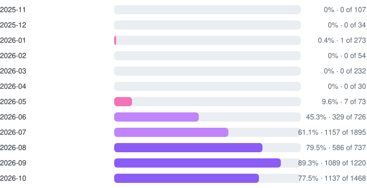

<!--
  GENERATED FILE — do not edit AI-STATS.md by hand.
  Source: scripts/templates/AI-STATS.template.md, rendered daily by
  scripts/build-ai-stats.sh from ai-stats.json (scripts/collect-ai-stats.mjs).
-->

# AI pair-programming statistics

How much of my code is written together with an AI assistant, and whether that changes how the work flows. Everything on this page is computed from the GitHub API over the last 12 months of my own commits and merged pull requests, public and private; private repositories appear only as one aggregated row.

| AI-assisted share | Commits scanned | Repositories | Lines added / removed |
|:--:|:--:|:--:|:--:|
| **62.6%** <sub>4,401 of 7,028 commits</sub> | **7,028** <sub>2025-10-27 → 2026-10-27</sub> | **142** <sub>with commits in the window</sub> | **+5,076,554** / **−754,166** |

## Share of AI-assisted commits over time

Share of my commits per month that carry an AI co-author trailer (bars span 0–100 %).

<picture>
  <source media="(prefers-color-scheme: dark) and (max-width: 600px)" srcset="assets/charts/ai-share-dark-mobile.svg">
  <source media="(max-width: 600px)" srcset="assets/charts/ai-share-light-mobile.svg">
  <source media="(prefers-color-scheme: dark)" srcset="assets/charts/ai-share-dark.svg">
  
</picture>

<details>
<summary>As a table</summary>

| Month | Share | AI / all commits |
|:--|--:|--:|
| 2025-11 | 0% | 0 / 107 |
| 2025-12 | 0% | 0 / 34 |
| 2026-01 | 0.4% | 1 / 273 |
| 2026-02 | 0% | 0 / 54 |
| 2026-03 | 0% | 0 / 232 |
| 2026-04 | 0% | 0 / 30 |
| 2026-05 | 9.6% | 7 / 73 |
| 2026-06 | 45.3% | 329 / 726 |
| 2026-07 | 61.1% | 1157 / 1895 |
| 2026-08 | 79.4% | 586 / 738 |
| 2026-09 | 89.3% | 1090 / 1221 |
| 2026-10 | 75.1% | 1231 / 1639 |

</details>

<details>
<summary>Weekly view (last 26 ISO weeks, 2026-W19 → 2026-W44)</summary>

```
AI share   ▁▁▃▁▂▁▂▅▆▆▃▅██▆▇▇██▇▇▇█▇▅▄
commits    ▁▁▁▁▁▁▃▇▄▇▇█▄▂▄▃▄▂▂▅█▇▆█▆▂
```

| Week | AI / all | Share |
|:--|--:|--:|
| 2026-W19 | 0 / 2 | 0% |
| 2026-W20 | 0 / 18 | 0% |
| 2026-W21 | 6 / 26 | 23.1% |
| 2026-W22 | 0 / 20 | 0% |
| 2026-W23 | 8 / 39 | 20.5% |
| 2026-W24 | 2 / 34 | 5.9% |
| 2026-W25 | 14 / 166 | 8.4% |
| 2026-W26 | 305 / 487 | 62.6% |
| 2026-W27 | 158 / 225 | 70.2% |
| 2026-W28 | 351 / 462 | 76% |
| 2026-W29 | 159 / 461 | 34.5% |
| 2026-W30 | 310 / 560 | 55.4% |
| 2026-W31 | 198 / 208 | 95.2% |
| 2026-W32 | 59 / 62 | 95.2% |
| 2026-W33 | 179 / 245 | 73.1% |
| 2026-W34 | 134 / 173 | 77.5% |
| 2026-W35 | 195 / 237 | 82.3% |
| 2026-W36 | 88 / 90 | 97.8% |
| 2026-W37 | 110 / 115 | 95.7% |
| 2026-W38 | 259 / 330 | 78.5% |
| 2026-W39 | 480 / 531 | 90.4% |
| 2026-W40 | 368 / 443 | 83.1% |
| 2026-W41 | 342 / 373 | 91.7% |
| 2026-W42 | 407 / 524 | 77.7% |
| 2026-W43 | 243 / 402 | 60.4% |
| 2026-W44 | 24 / 52 | 46.2% |

</details>

## Per repository

Public repositories by name, ordered by commits in the window. Private, forked and archived repositories (and this profile repo) are rolled up into one row.

| Repository | Share | | AI / all commits |
|:--|:--|--:|--:|
| [netpaw](https://github.com/smol-kitten/netpaw) <sub>smol-kitten</sub> | `██████████████░░░░░░` | 72% | 139 / 193 |
| [common-ressources](https://github.com/smol-kitten/common-ressources) <sub>smol-kitten</sub> | `████████████████░░░░` | 78.9% | 60 / 76 |
| [web-core](https://github.com/smol-kitten/web-core) <sub>smol-kitten</sub> | `█████░░░░░░░░░░░░░░░` | 23.3% | 14 / 60 |
| [MinecraftThroughTime](https://github.com/smol-kitten/MinecraftThroughTime) <sub>smol-kitten</sub> | `████████████░░░░░░░░` | 58.3% | 21 / 36 |
| [catboy-registry](https://github.com/smol-kitten/catboy-registry) <sub>smol-kitten</sub> | `████████████░░░░░░░░` | 60% | 15 / 25 |
| [pawkit-docgen](https://github.com/smol-kitten/pawkit-docgen) <sub>smol-kitten</sub> | `███████████████████░` | 95.8% | 23 / 24 |
| [netpaw-site](https://github.com/smol-kitten/netpaw-site) <sub>smol-kitten</sub> | `████████████████████` | 100% | 8 / 8 |
| [.github](https://github.com/smol-kitten/.github) <sub>smol-kitten</sub> | `█████░░░░░░░░░░░░░░░` | 25% | 1 / 4 |
| *133 private / other repos* | `████████████░░░░░░░░` | 62.4% | 4,109 / 6,583 |

## Pull requests: with and without AI commits

2,527 merged pull requests sampled (up to 40 most recent per repository, bot authors excluded). A PR counts as "with AI" when at least one of its commits is AI-assisted.

| | With AI commits | Without AI commits |
|:--|--:|--:|
| Pull requests | **1,760** | **767** |
| Median time to merge | **6 min** | **0 min** |
| Mean time to merge | 9.8 h | 23.3 h |
| Median commits per PR | 1 | 1 |
| Median lines changed per PR | 65 | 18 |
| CI pass rate of the head commit | 79.8% <sub>n = 1,501</sub> | 33.7% <sub>n = 715</sub> |

<sub>CI pass rates describe different kinds of PRs (small manual fixes vs assisted feature work), not an effect of AI use; failures include infrastructure noise.</sub>

## Lines changed

| | AI-assisted commits | Human-only commits |
|:--|--:|--:|
| Commits | 4,401 | 2,627 |
| Lines added | +2,517,899 | +2,558,655 |
| Lines removed | −284,461 | −469,705 |
| Lines changed per commit | **637** | **1,153** |

<details>
<summary>Lines changed per month (bar = AI-assisted share of the month's volume, scaled to the busiest month)</summary>

| Month | | AI-assisted lines | All lines |
|:--|:--|--:|--:|
| 2025-11 | `░░░░░░░░░░░░░░░░░░░░` | 0 | 88,752 |
| 2025-12 | `░░░░░░░░░░░░░░░░░░░░` | 0 | 27,671 |
| 2026-01 | `█░░░░░░░░░░░░░░░░░░░` | 13,125 | 684,989 |
| 2026-02 | `░░░░░░░░░░░░░░░░░░░░` | 0 | 143,584 |
| 2026-03 | `░░░░░░░░░░░░░░░░░░░░` | 0 | 300,735 |
| 2026-04 | `░░░░░░░░░░░░░░░░░░░░` | 0 | 24,453 |
| 2026-05 | `█░░░░░░░░░░░░░░░░░░░` | 5,089 | 184,199 |
| 2026-06 | `██░░░░░░░░░░░░░░░░░░` | 171,786 | 432,731 |
| 2026-07 | `██████████░░░░░░░░░░` | 739,584 | 907,587 |
| 2026-08 | `████░░░░░░░░░░░░░░░░` | 314,689 | 449,545 |
| 2026-09 | `██████████████░░░░░░` | 966,614 | 1,424,062 |
| 2026-10 | `████████░░░░░░░░░░░░` | 591,473 | 1,159,414 |

</details>

## How this is measured

- **AI-assisted commit**: a commit authored by me on the default branch whose message carries at least one `Co-authored-by:` trailer naming an AI assistant (Anthropic e-mail domain or a known assistant name). Commits without a trailer count as human-only, even if an assistant was consulted. Bot commits (for example the daily stats update) are not mine and are not counted.
- **Window**: commits with a committed date in the last 365 days, across every repository I own or am a member of in the `smol-kitten` organisation that received a push in that window.
- **Share**: AI-assisted commits divided by all my commits in the same period.
- **Pull requests**: the most recent merged PRs per repository (capped, see the PR section), excluding PRs opened by bots such as Dependabot. A PR is "with AI" if any of its commits is AI-assisted. Merge time is `mergedAt − createdAt`; the median is reported because a few long-lived PRs dominate the mean. CI pass rate uses the status-check rollup of the PR's head commit; PRs without checks are left out of the rate. Two caveats: most PRs are opened and merged by my own automation right after CI, so the median merge time is close to zero for both groups and the mean is the more telling number; and a failed rollup includes infrastructure failures (artifact-storage quota, runner outages) that say nothing about the code.
- **Lines changed**: additions + deletions as reported by GitHub for each commit; generated files and lockfiles are not excluded, so single large commits can move the per-commit figure.
- **What this cannot tell you**: whether the AI-assisted code is better or worse, how much of a commit the assistant wrote, or anything about work that never became a commit.

Numbers are rebuilt daily by [`update-stats.yml`](.github/workflows/update-stats.yml); the collector is [`scripts/collect-ai-stats.mjs`](scripts/collect-ai-stats.mjs) and the renderer [`scripts/build-ai-stats.sh`](scripts/build-ai-stats.sh). Back to the [profile](README.md).

<sub>Last updated 2026-10-27.</sub>
