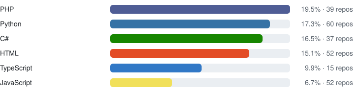

<!--
  GENERATED FILE — do not edit README.md by hand.
  Source: scripts/templates/README.template.md, rendered daily by
  scripts/build-readme.sh from stats.json (.github/workflows/update-stats.yml).
  Every GEN placeholder line in the template is replaced by a generated block.
-->

<picture>
  <source media="(prefers-color-scheme: dark) and (max-width: 600px)" srcset="assets/banner-dark-mobile.svg">
  <source media="(max-width: 600px)" srcset="assets/banner-light-mobile.svg">
  <source media="(prefers-color-scheme: dark)" srcset="assets/banner-dark.svg">
  
</picture>

Hi, I'm Marc (`polo-nyan`), a self-taught hobby developer from Germany. I build backend services and the automation around them, run a small self-hosted fleet, and work on game development, machine learning and IoT on the side. Most of my code lives in the [smol-kitten](https://github.com/smol-kitten) organisation; the larger part of it is private, but the numbers below include it.

## 🛠️ Current projects

| Project | What it is |
|:--|:--|
| [netpaw](https://github.com/smol-kitten/netpaw) · [site](https://netpaw.catboy.systems) | Static-IP profiles for Windows network admins: tray tool, hotkeys, multi-subnet secondaries, device presets, VLAN detection <sub>C#</sub> |
| [catboy-registry](https://github.com/smol-kitten/catboy-registry) | OID registry, protocol specs and generated constants for the catboy.systems IANA enterprise arc <sub>Go templates</sub> |
| [MinecraftThroughTime](https://github.com/smol-kitten/MinecraftThroughTime) | Switches Minecraft versions on a date schedule from a profile <sub>C#</sub> |
| [web-core](https://github.com/smol-kitten/web-core) | Base images for PHP 8.4 on nginx and Apache <sub>Docker</sub> |

<details>
<summary>Recently pushed public repos</summary>

| Repository | Description | Language | Last push |
|:--|:--|:--|:--|
| [netpaw](https://github.com/smol-kitten/netpaw) | Static-IP profiles for Windows network admins — tray tool with hotkeys, multi-subnet se… | C# | 2026‑10‑29 |
| [fleet-actions](https://github.com/workcollection/fleet-actions) | Shared composite actions + reusable workflows for the fleet. Consume by tag (@v1), neve… | Python | 2026‑10‑29 |
| [common-ressources](https://github.com/smol-kitten/common-ressources) | Ressources i might or might not need more often | Lua | 2026‑10‑29 |
| [pawkit-docgen](https://github.com/smol-kitten/pawkit-docgen) | Deterministic code-index + wiki generators for the pawkit agent toolkit (public CI mirr… | Python | 2026‑10‑28 |
| [web-core](https://github.com/smol-kitten/web-core) | Base images for php8.4 nginx/apache2 | HTML | 2026‑10‑21 |
| [MinecraftThroughTime](https://github.com/smol-kitten/MinecraftThroughTime) | Tool to change MC Versions at specific dates from a profile | C# | 2026‑10‑20 |

</details>

## 📊 By the numbers

| Repositories | Contributions <sub>12 mo</sub> | Active days <sub>12 mo</sub> | PRs merged | CI success |
|:--:|:--:|:--:|:--:|:--:|
| **146** <sub>13 public · 133 private</sub> | **12,777** | **230** | **4,855** <sub>of 5,071 · 95.7%</sub> | **90.3%** <sub>of 421 runs</sub> |

**Languages** <sub>by bytes across all repos, incl. private</sub>

<picture>
  <source media="(prefers-color-scheme: dark) and (max-width: 600px)" srcset="assets/charts/languages-dark-mobile.svg">
  <source media="(max-width: 600px)" srcset="assets/charts/languages-light-mobile.svg">
  <source media="(prefers-color-scheme: dark)" srcset="assets/charts/languages-dark.svg">
  
</picture>

<details>
<summary>All languages as a table</summary>

| Language | Share | Repos |
|:--|--:|--:|
| PHP | 19.4% | 39 |
| Python | 17.6% | 60 |
| C# | 16.4% | 37 |
| HTML | 15.0% | 52 |
| TypeScript | 9.9% | 15 |
| JavaScript | 6.7% | 52 |
| Go | 3.7% | 6 |
| Shell | 2.5% | 79 |
| CSS | 2.0% | 47 |
| Lua | 1.4% | 5 |

</details>

<details>
<summary>Activity details</summary>

| Contributions <sub>past 12 months, incl. private</sub> | |
|:--|--:|
| Last 30 / 90 days | **3,376** / **6,503** |
| Current streak | **30 days** |
| Longest streak | **50 days** |
| Busiest day | **453** <sub>2026-09-23</sub> |

**Commit clock** <sub>UTC, 3896 sampled commits · busiest: Wed around 11:00</sub>

```
00h ▄▃▂▂▄▆▆▅█▇██▇▅▅▆▅▄▄▅▅▆▅▄ 23h
```

**Repositories created per year**

| Year | | Repos |
|:--|:--|--:|
| 2020 | `█░░░░░░░░░░░` | 1 |
| 2021 | `█░░░░░░░░░░░` | 6 |
| 2022 | `█░░░░░░░░░░░` | 5 |
| 2023 | `█░░░░░░░░░░░` | 4 |
| 2024 | `█░░░░░░░░░░░` | 8 |
| 2025 | `████░░░░░░░░` | 29 |
| 2026 | `████████████` | 93 |

</details>

<sub>AI pair-programming: **57.8%** of recent commits carry an AI co-author trailer. Full analysis in [AI-STATS.md](AI-STATS.md).</sub>

## 🧰 Toolbox

| | |
|:--|:--|
| **Languages** | C# / .NET, PHP, Python, TypeScript, Go, Bash |
| **Data** | MariaDB, MySQL, Redis |
| **Infra** | Linux, Docker, nginx, GitHub Actions on self-hosted runners, Grafana |
| **Game & hardware** | Unity, Arduino |
| **Learning** | ML / AI, IoT |

<details>
<summary>Elsewhere</summary>

- Organisation: [smol-kitten](https://github.com/smol-kitten)
- Projects site: [netpaw.catboy.systems](https://netpaw.catboy.systems)

</details>

---

<sub>Rebuilt every morning by a self-hosted runner, usually before I have had coffee. Private project names are never shown here, only counts. If the stats look stale the pipeline is down and development continues on a private Gitea mirror.</sub>

<sub>Last updated 2026-10-29.</sub>
